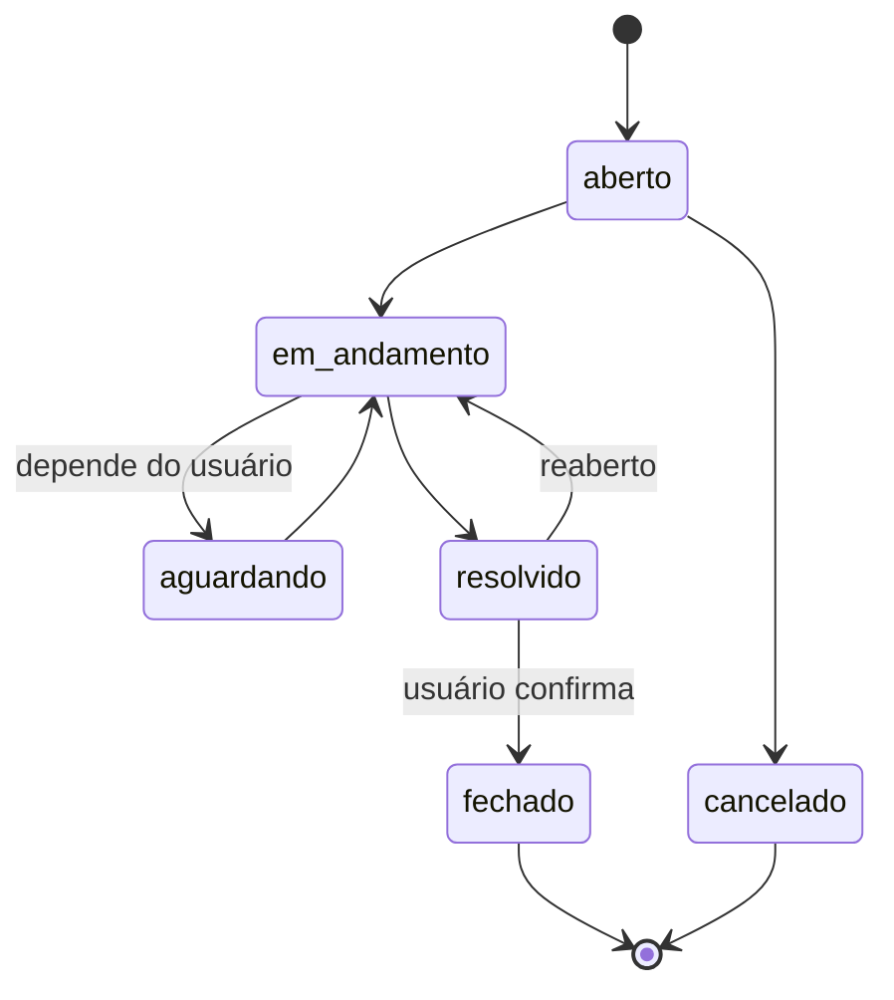
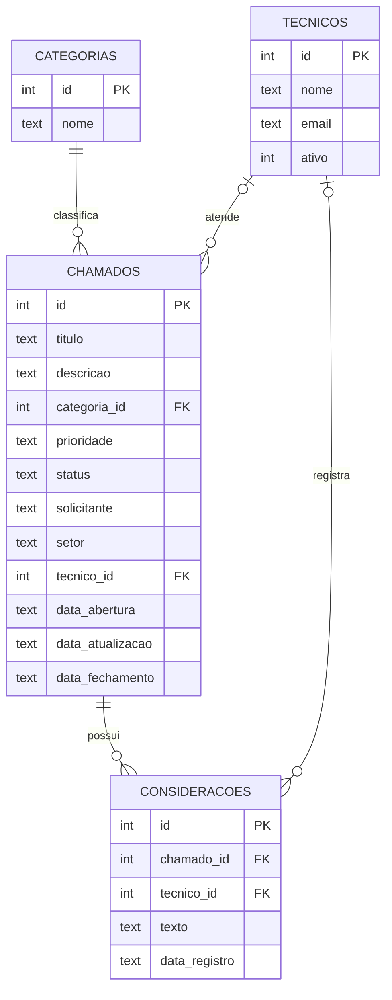
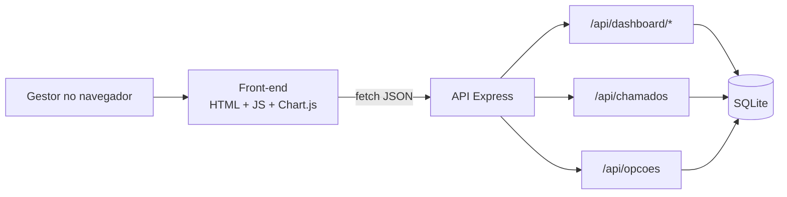

# Análise e modelagem

## 1. Contexto

O Thindesk é o sistema de chamados usado pelo suporte de TI. Os usuários dos setores abrem chamados e os
técnicos atendem. O responsável pelo suporte precisava de uma visão geral da operação para responder perguntas como:

- Quantos chamados estão parados e há quanto tempo?
- A equipe está dando conta da demanda (resolvemos tanto quanto abrimos)?
- Que tipo de problema mais aparece? Vale investir em prevenção em alguma área?
- Algum técnico está sobrecarregado?

O dashboard foi pensado em cima dessas perguntas.

## 2. Atores

| Ator | Descrição |
|------|-----------|
| Responsável pelo suporte (gestor) | Usuário principal do painel. Acompanha indicadores, filtra dados e toma decisões |
| Técnico | Atualiza status dos chamados e registra considerações técnicas |
| Solicitante | Quem abre o chamado (não usa o painel, mas aparece nos dados) |

## 3. Requisitos funcionais

| Código | Requisito | Detalhamento |
|--------|-----------|--------------|
| RF01 | Indicadores gerais | Total, pendentes (abertos, em andamento, aguardando), concluídos, cancelados, taxa de resolução, tempo médio de resolução, % dentro do SLA e pendentes atrasados |
| RF02 | Análise por período | Gráfico com chamados abertos e resolvidos ao longo do tempo, agrupados por dia, semana ou mês |
| RF03 | Situação dos chamados | Distribuição dos chamados por status e por prioridade |
| RF04 | Tipos mais atendidos | Ranking das categorias por chamados atendidos, com participação e tempo médio. Complementado com ranking por técnico |
| RF05 | Filtros | Período, status, categoria, prioridade, técnico e setor, aplicados a todos os componentes do painel |
| RF06 | Integração com a API | Todo dado exibido vem da API REST |
| RF07 | Atualização e tratamento | Atualização periódica, edição de status/técnico, registro de considerações, validação e formatação dos dados |

## 4. Requisitos não funcionais

- **RNF01** - Rodar com um único comando (`npm start`), sem depender de serviço externo de banco.
- **RNF02** - A API deve validar os parâmetros e devolver erros em JSON com mensagem clara (HTTP 400/404).
- **RNF03** - O painel deve funcionar em telas menores (layout responsivo).
- **RNF04** - Os filtros devem ser tratados da mesma forma em todos os endpoints (uma única função monta o `WHERE`).
- **RNF05** - Consultas parametrizadas para evitar SQL injection.

## 5. Regras de negócio

**RN01 - SLA por prioridade.** Cada prioridade tem um tempo máximo de resolução:

| Prioridade | SLA |
|------------|-----|
| Crítica | 4 horas |
| Alta | 8 horas |
| Média | 24 horas |
| Baixa | 72 horas |

O tempo é contado em horas corridas, da abertura até o fechamento (ou até agora, se ainda estiver pendente).

**RN02 - Chamado atrasado.** Um chamado pendente é considerado atrasado quando o tempo decorrido passa do SLA da prioridade.

**RN03 - Pendente x concluído.** São pendentes os status `aberto`, `em_andamento` e `aguardando`.
São concluídos `resolvido` e `fechado`. `cancelado` não entra nem como pendente nem como concluído.

**RN04 - Taxa de resolução.** `concluídos / (total - cancelados)`. Cancelados ficam de fora porque não representam atendimento.

**RN05 - Data de fechamento.** Ao mudar para resolvido, fechado ou cancelado a API grava a data de fechamento.
Se o chamado for reaberto (voltar para um status pendente), a data é apagada.

**RN06 - Tempo médio de resolução.** Média das horas entre abertura e fechamento apenas dos chamados concluídos.

### Ciclo de vida do chamado

## 6. Modelo de dados

Algumas decisões:

- `status` e `prioridade` ficaram como texto com `CHECK` em vez de tabelas separadas, porque são valores fixos
  que fazem parte das regras de negócio (o SLA depende da prioridade).
- `tecnico_id` pode ser nulo: o chamado pode estar aberto e ainda não ter sido assumido por ninguém.
- As datas são gravadas como texto no formato `AAAA-MM-DD HH:MM:SS`, que o SQLite consegue usar nas funções
  `date()`, `julianday()` e `strftime()` para os agrupamentos e cálculos de tempo.
- Foram criados índices em `data_abertura`, `data_fechamento` e `status`, que são as colunas mais usadas nos filtros.

## 7. Arquitetura

O Express serve tanto a API (`/api/...`) quanto os arquivos estáticos do front-end, então não há problema de CORS
e tudo sobe com um único processo.

O front-end faz as consultas do dashboard em paralelo (`Promise.all`) sempre que os filtros mudam ou no intervalo
de atualização automática.
