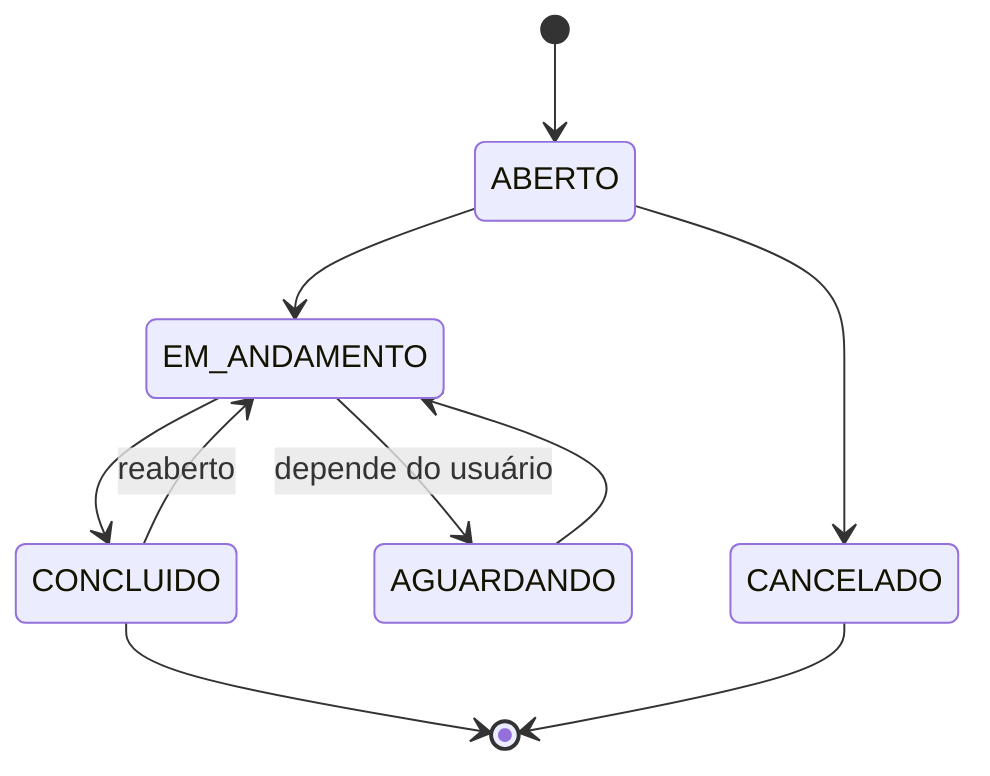
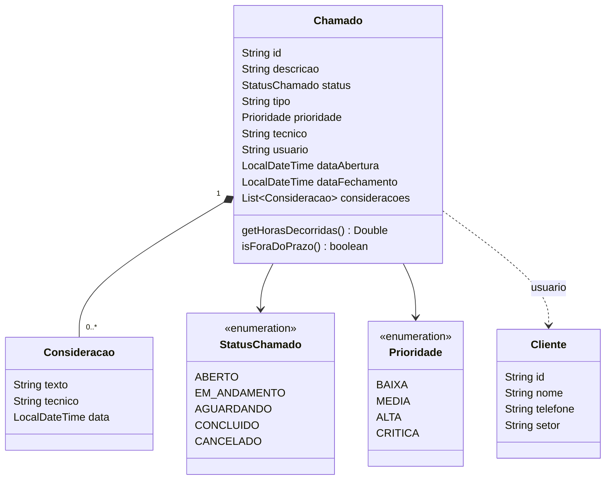
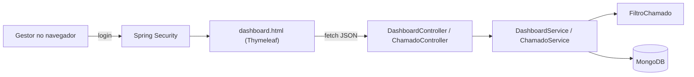

# Análise e modelagem

## 1. Contexto

O Thindesk é o sistema de chamados usado pelo suporte de TI. Os usuários (clientes) abrem chamados e os técnicos
atendem. O projeto base já tinha o cadastro e a listagem de chamados, clientes e horários de atendimento, mas não
havia nenhuma visão gerencial.

O responsável pelos chamados precisava responder perguntas como:

- Quantos chamados estão parados e há quanto tempo?
- A equipe está dando conta da demanda (concluímos tanto quanto abrimos)?
- Que tipo de problema mais aparece?
- Algum técnico está sobrecarregado ou atrasando os atendimentos?

O dashboard foi pensado em cima dessas perguntas.

## 2. Atores

| Ator | Descrição |
|------|-----------|
| Responsável pelos chamados (gestor) | Usuário principal do dashboard. Acompanha indicadores, aplica filtros e toma decisões |
| Técnico | Atualiza o status dos chamados e registra considerações técnicas |
| Usuário / cliente | Quem abre o chamado. Não usa o dashboard, mas aparece nos dados |

## 3. Requisitos funcionais

| Código | Requisito | Detalhamento |
|--------|-----------|--------------|
| RF01 | Indicadores gerais | Total, pendentes, concluídos, cancelados, taxa de resolução, tempo médio de resolução, % dentro do SLA, pendentes atrasados e pendentes sem técnico |
| RF02 | Análise por período | Gráfico de chamados abertos e concluídos ao longo do tempo, agrupados por dia, semana ou mês |
| RF03 | Situação dos chamados | Distribuição por status e por prioridade |
| RF04 | Tipos mais atendidos | Ranking dos tipos de chamado por quantidade atendida, com participação e tempo médio. Complementado pelo ranking de técnicos |
| RF05 | Filtros | Período, status, tipo, prioridade e técnico, aplicados a todos os componentes |
| RF06 | Integração com a API | Todos os dados exibidos vêm da API REST |
| RF07 | Atualização e tratamento | Atualização periódica, alteração de status/técnico, registro de considerações, validação e formatação dos dados |

## 4. Requisitos não funcionais

- **RNF01** - Seguir a arquitetura do projeto base (Controller → Service → Repository, Spring Boot + MongoDB + Thymeleaf).
- **RNF02** - O dashboard deve exigir login (Spring Security, já existente no projeto).
- **RNF03** - A API deve validar os parâmetros e responder erros em JSON com mensagem clara (HTTP 400 / 404).
- **RNF04** - Os filtros devem funcionar da mesma forma em todos os endpoints (uma única classe monta a consulta: `FiltroChamado`).
- **RNF05** - Credenciais do banco não devem ficar no código-fonte (uso da variável `MONGODB_URI`).
- **RNF06** - Layout responsivo, usando o Bootstrap que o projeto já utiliza.

## 5. Regras de negócio

**RN01 - SLA por prioridade.** Cada prioridade tem um tempo máximo de resolução:

| Prioridade | SLA |
|------------|-----|
| Crítica | 4 horas |
| Alta | 8 horas |
| Média | 24 horas |
| Baixa | 72 horas |

O tempo é contado em horas corridas, da abertura até o fechamento (ou até o momento atual, se ainda estiver pendente).

**RN02 - Chamado atrasado.** Um chamado pendente está atrasado quando o tempo decorrido passa do SLA da sua prioridade.

**RN03 - Pendente x encerrado.** São pendentes `ABERTO`, `EM_ANDAMENTO` e `AGUARDANDO`.
São encerrados `CONCLUIDO` e `CANCELADO`.

**RN04 - Taxa de resolução.** `concluídos / (total - cancelados)`. Cancelados ficam de fora porque não representam atendimento.

**RN05 - Data de fechamento.** Ao mudar para concluído ou cancelado, a data de fechamento é gravada automaticamente.
Se o chamado voltar para um status pendente (reaberto), a data é apagada.

**RN06 - Tempo médio de resolução.** Média das horas entre abertura e fechamento, considerando só os chamados concluídos.

**RN07 - Valores padrão.** Um chamado novo começa com status `ABERTO`, prioridade `MEDIA` e data de abertura igual ao momento do cadastro.

### Ciclo de vida do chamado



## 6. Modelo de dados

O MongoDB guarda documentos, então as considerações técnicas ficam **dentro** do documento do chamado
(subdocumentos). Elas sempre são lidas junto com o chamado e não fazem sentido sozinhas, por isso não criei uma
coleção separada.



Exemplo de documento na coleção `chamados`:

```json
{
  "_id": "6735f1a2c3d4e5f6a7b8c9d0",
  "descricao": "Impressora não imprime",
  "status": "CONCLUIDO",
  "tipo": "Impressora",
  "prioridade": "MEDIA",
  "tecnico": "Juliana Rocha",
  "usuario": "Renata Carvalho",
  "dataAbertura": "2026-11-10T09:12:00",
  "dataFechamento": "2026-11-10T14:40:00",
  "consideracoes": [
    { "texto": "Fila de impressão travada, serviço reiniciado.", "tecnico": "Juliana Rocha", "data": "2026-11-10T14:35:00" }
  ]
}
```

Decisões:

- `getHorasDecorridas()` e `isForaDoPrazo()` são calculados na hora (não ficam salvos), porque o tempo de um
  chamado pendente muda a cada minuto.
- `tipo` e `tecnico` continuaram como texto, como no projeto base. As opções dos filtros são montadas com os valores
  distintos que existem no banco (`findDistinct`).
- `dataAbertura` tem índice, porque é o campo usado no filtro de período em praticamente todas as consultas.

## 7. Arquitetura



- **Controller**: recebe a requisição e os filtros (o Spring converte a query string em `FiltroChamado`).
- **Service**: aplica as regras de negócio e calcula os indicadores.
- **FiltroChamado**: monta a `Query` do MongoDB com os filtros preenchidos, para todos os endpoints usarem a mesma lógica.
- **ApiExceptionHandler**: padroniza os erros da API em JSON.

A página `dashboard.html` só monta a estrutura (cards, gráficos, tabelas). O `dashboard.js` busca os dados na API
em paralelo (`Promise.all`) sempre que os filtros mudam e a cada 60 segundos.
